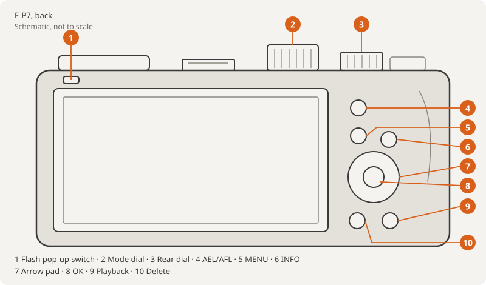
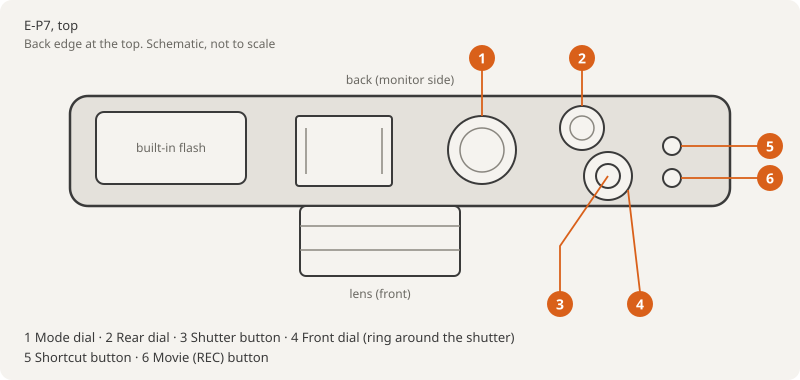
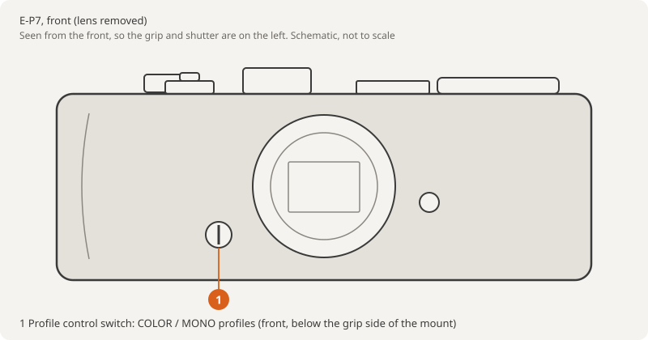
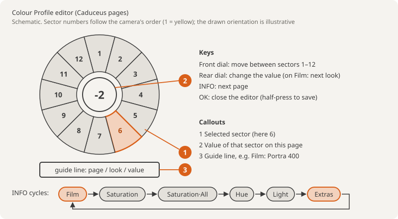

# Caduceus quick guide (E-P7, v0.31d)

A short cheat sheet for using Caduceus on the camera. Full feature list: [README](../README.md). Changes per
version: [CHANGELOG](../CHANGELOG.md).

## Controls used in this guide

The drawings are schematic, made for this guide. Positions follow OM's E-P7 manual (Names of parts) and Imaging
Resource's E-P7 preview.

| Control | Where | What it does in Caduceus |
|---|---|---|
| Shutter button | top, right | **First half-press after power-on loads the card files**; half-press after editing saves |
| Front dial | ring around the shutter | Editor: choose sector 1–12 |
| Rear dial | top, behind the shutter | Editor: change the value; on the Film page, step through looks |
| Profile control switch | front, below the grip side of the mount | COLOR / MONO profiles (stock) |
| INFO | back, right of MENU | Editor: next page |
| OK | centre of the arrow pad | Close the editor; held at power-on = flash firmware |
| Shortcut button | top, beside the shutter | Back to the profile control screen (stock) |
| Movie (REC) button | top, beside the Shortcut button | Stock; more choices in Button Function |
| Arrow pad (right, down) | back | Assignable in Button Function (v0.29+) |
| MENU, Playback | back | Leave the editor |

## 1. Install, update, restore

Follow the README; the steps aren't repeated here.

| Task | Where |
|---|---|
| Install | [README › Install](../README.md#install), more detail in [INSTALL.md](INSTALL.md) |
| Update to a newer Caduceus | Same steps; flash over the old version, no restore needed. Keep `EP7MOD/BUNDLES.BIN` (your slots), replace `LOOKS.BIN` |
| Back to stock | [README › Undo / go back to stock](../README.md#undo--go-back-to-stock) |
| Check the version | Setup › Firmware shows `Caduceus: 0.31d` |

## 2. Every power-on: half-press once

Nothing is read from the card at boot. The **first half-press** loads `EP7MOD/`:

| File | Holds |
|---|---|
| `LOOKS.BIN` | the film library shown on the Film page |
| `BUNDLES.BIN` | COLOR1–4: which look each slot holds, plus your edits (the camera rewrites it, keeps a `.BAK`) |
| `MOVIE.BIN` / `AP.BIN` | the Movie colour and AP Custom colour slots |

Until that half-press, or with no `EP7MOD` folder, the colour wheel is stock.

## 3. Open the editor and move between pages

1. Mode dial on P, A, S, M or B. Turn the **profile control switch** (front) to COLOR.
2. Pick COLOR1–4 (left/right or the rear dial), then up/down to the colour wheel (stock name: Saturation Level).
3. The wheel opens on **Film**. **INFO** steps through the pages:

| Page | Front dial | Rear dial |
|---|---|---|
| Film | – | step through looks (`Film: Portra 400` … `Stock`) |
| Saturation | sector | saturation −5..+5 (stock) |
| Saturation·All | – | all colours at once (stock) |
| Hue | sector | shift that colour |
| Light | sector | brighten / darken that colour |
| Effects | sector 1–7 | the setting in the tables below |
| Colour & Light | sector 1–8 | the setting in the tables below |

4. Close the editor (OK), then **half-press** to save to the card.

- `*` after a look name = changed since you picked it. The photo's EXIF gets the name too (`Gold 200*`).
- If you close on Saturation·All, the wheel reopens there.
- **Movie colour:** movie mode, picture mode Vivid (`INFO Custom`), press INFO. **AP Custom:** AP dial position,
  Super Control Panel, picture-mode cell on Vivid, press INFO. Same pages; Grain, Glow/Clarity, Art and Halo read
  `…: stills` there.

## 4. The Effects and Colour & Light pages (v0.32)

**Effects**

| Sector | Setting | Values | Set by |
|---|---|---|---|
| 1 | Grain | Off / Low / Med / High | **you** (profile) |
| 2 | Glow ← → Clarity | −5..+5 (− glow, + clarity) | look |
| 3 | Halo (tinted halation) | Off / Low / Med / High | look, you can change it after |
| 4 | Art Effect | Off / Star Light / Pin Hole | look |
| 5 | Sharp (sharpening) | Camera / Off | **you** (profile) |
| 6 | NR (noise reduction) | Camera / Std / Low / Off | **you** (profile) |
| 7 | VigFix (lens vignette correction) | Off / Camera | look |

**Colour & Light**

| Sector | Setting | Values | Set by |
|---|---|---|---|
| 1 | WB amber / blue | −5..+5 | look |
| 2 | WB green / magenta | −5..+5 | look |
| 3 | Blacks | −5..+5 | look |
| 4 | Whites | −5..+5 | look |
| 5 | Shadow tone colour | Off / 12 colours | look |
| 6 | Shadow tone strength | −5..+5 (− = opposite tint) | look |
| 7 | Highlight tone colour | Off / 12 colours | look |
| 8 | Highlight tone strength | −5..+5 | look |

Picking a tone colour while its strength is 0 sets it to +3. Grain and Halo are stills only and add a few seconds to
saving. Split tone is COLOR1–4 only (`Split: COLOR 1-4` on Movie and AP). On v0.31d and earlier these are one Extras
page: 1 Grain, 2 Glow/Clarity, 3–4 WB, 5 Art, 6 Blacks, 7 Whites, 8 VigFix, 9 NR, 10 Sharp, 11 Halo.

## 5. Looks vs profile settings

| | Look | Profile setting |
|---|---|---|
| What | Film pick, hue / light / saturation, glow-clarity, WB shift, Art, Blacks / Whites, VigFix, Halo, tone curve | **Grain, NR, Sharp** |
| Changed by picking a look | yes | **never** |
| Comes from | `LOOKS.BIN` (Control Panel or built-in) | you, per COLOR slot |
| Counts for `*` | yes | no |

Example: COLOR2 has Grain Med and Sharp Off. Switching COLOR2 from Portra 400 to Velvia keeps Grain Med and Sharp Off.

## 6. Control Panel → card

[Caduceus Control Panel](https://cakelesscoder.github.io/caduceus-ep7/) runs in the browser; photos never leave it.

| Step | Do |
|---|---|
| 1 | Setup pop-up (later the **Camera** button): choose **E-P7**. **Firmware** button: choose your version (v0.31) |
| 2 | Edit a look or make a new one; check the preview (approximate) |
| 3 | Optional: **Share** for a `pk1_` code or link; paste one to import a look |
| 4 | **Export › LOOKS.BIN › Download** |
| 5 | Copy it to `EP7MOD/` on the card, replacing `LOOKS.BIN` (keep the name) |
| 6 | Camera on, half-press: the looks are on the Film page. No re-flash |

- Leave `BUNDLES.BIN` alone unless you want to reset your slots: the Export page's starter `BUNDLES.BIN` replaces
  your slot choices and on-camera edits.
- Per-profile Sharp and Halo on the Export page only go into a starter `BUNDLES.BIN`.
- Export can also save RapidRAW presets to use the looks on raw files from any camera.

## 7. Troubleshooting

| Symptom | Fix |
|---|---|
| Wheel looks stock (no `Film:` page) | Half-press once, then reopen the wheel. Check `DCOLYMP` and `EP7MOD` sit at the card's top level, next to `DCIM` |
| Setup › Firmware shows no Caduceus row | The update didn't run, or you flashed the restore file. Flash the build's `DCOLYMP/E1429999.BIN` |
| Files ignored after copying | Eject the card properly and copy again; a cut-short file is skipped |
| LED blinks fast at once when flashing | The camera rejected the file and wrote nothing. Rebuild and copy again |
| Edits lost | Half-press after closing the editor; that's when it saves |
| Keys stop responding or the camera restarts after a shot | Update to v0.33 or later first (it fixed a freeze with Grain). After a restart the camera writes `EP7MOD/CRASH.BIN` on the next half-press: attach it to a bug report. Effects are processed on the camera's own CPU; several heavy ones together (Grain + Halo + strong glow) can occasionally stall it. Power off and on, and drop one effect on that profile if it repeats |
| Effect missing in live view | Grain, Halo, Star Light and some effects show only in the saved photo |

More: [INSTALL.md › troubleshooting and FAQ](INSTALL.md). Bugs: [issues](https://github.com/cakelesscoder/caduceus-ep7/issues).
