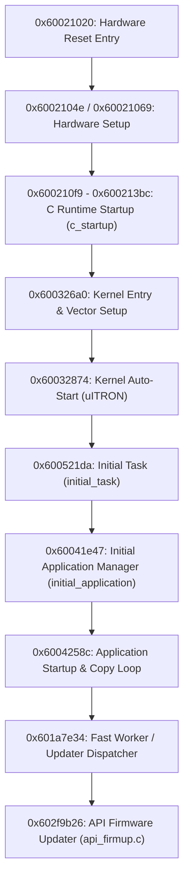

# Architecture & Memory Map: Olympus OM-D E-M1 Mark II (v3.70)

**Target Image**: `00_0100_40560020.decoded.bin` (Block 0, 23,068,608 bytes)  
**Processor Architecture**: Panasonic / Matsushita MN103 (AM32R 32-bit RISC core)  
**Operating System**: $\mu$ITRON Real-Time Operating System  

---

## 1. Memory Space Overview

The camera firmware operates across two distinct address regions:

| Address Space | Typical Mapping | Description |
| :--- | :--- | :--- |
| `0x40000000 - 0x47FFFFFF` | Flash Memory / ROM | Physical flash container addresses where blocks are stored. |
| `0x60000000 - 0x61FFFFFF` | Cached System RAM / Execution Code | Runtime mirrored execution addresses where code runs. |

### Block 0 Base Address Derivation
In the decoded payload of Block 0:
- **Container Load Address**: `0x40560000` (Header address), payload entry `0x40560020`.
- **Execution Base Address**: `BASE = 0x60021020`.
- **Proof of Base Address**:
  - String `"api_firmup.c"` is at raw file offset `0x004d6ed4`.
  - Target absolute address: `0x60021020 + 0x004d6ed4 = 0x604f7ef4`.
  - Exactly referenced by 32-bit pointer at file offset `0x002d8b46` (`0x602f9b66`).
  - First instruction at offset `0x00000000` corresponds to runtime address `0x60021020`.

---

## 2. Startup & Boot Sequence

The initial execution vector at `0x60021020` follows the standard Olympus TruePic bootloader stages:

### Detailed Boot Windows
| Symbol / Phase | Runtime Address Range | File Offset Range | Function / Responsibility |
| :--- | :--- | :--- | :--- |
| `main_entry` | `0x60021020 - 0x600210f9` | `0x00000000 - 0x000000d9` | Cold reset vector, disable interrupts, init CPU registers. |
| `c_startup` | `0x600210f9 - 0x600213bc` | `0x000000d9 - 0x0000039c` | Clear `.bss`, copy initialized data sections from flash. |
| `kernel_entry` | `0x600326a0 - 0x600327f1` | `0x00011680 - 0x000117d1` | Initialize $\mu$ITRON system control blocks and dispatchers. |
| `kernel_auto_start` | `0x60032874 - 0x600328c4` | `0x00011854 - 0x000118a4` | Start first RTOS scheduling round. |
| `initial_task` | `0x600521da - 0x60052333` | `0x000311ba - 0x00031313` | Spawn initial system threads and peripheral tasks. |
| `initial_application` | `0x60041e47 - 0x600420f2` | `0x00020e27 - 0x000210d2` | Prepare application workspace and event queues. |
| `application_startup`| `0x6004258c - 0x60042b02` | `0x0002156c - 0x00021ae2` | Run C++ static constructors and verify flash integrity. |

---

## 3. Registered RTOS Tasks & Subsystems

The $\mu$ITRON kernel manages asynchronous tasks using system mailboxes and event flags:

- `GUI_TASK`: User interface rendering, button handling, dial rotation events.
- `TAKE_MOV_TASK`: Video recording engine, H.264/MOV streaming buffer manager.
- `MVR_TASK`: Movie recording controller and frame encoder dispatch.
- `MDET_CALC_FLAME_TASK`: Motion detection and frame calculation worker.
- `HLS_ACTBATTERY_TASK`: Battery health, fuel-gauge monitoring, and power management.
- `GPI_TIM_TASK`: General purpose input timer task for GPIO debouncing.

---

## 4. Subsystem Prefixes

The firmware exposes structured subsystems identifiable by common symbol and module prefixes:

| Subsystem Prefix | Count | Description |
| :--- | :--- | :--- |
| `api_*` | 100+ | Public application API layer (`api_firmup.c`, `api_exec.c`, `api_eventque.c`, `api_disp.c`, `api_media.c`, `api_wifi.c`). |
| `cam_*` | 93+ | Camera core imaging hardware drivers (`cam_aedrv.c`, `cam_afdrv.c`, `cam_lens.c`, `cam_imgdev.c`). |
| `fcs_*` | 126+ | Focus Control System: autofocus bracket calculation, phase-detect AF area selection (`fcs_af_crtr_area_adr`). |
| `stb_*` | 115+ | Strobe / External Flash driver and light calculation (`stb_ext_firmup.c`, `stb_seq_flash.c`). |
| `play_*` | 658+ | Playback engine, image rotation, RAW development playback, thumbnail generation, BGM audio player (`play_rom.c`). |
| `albm_*` | 45+ | Album and DCIM file database indexer (`albm_main.c`, `albm_os.c`). |
| `dcf*` | 79+ | Design Rule for Camera File System (DCF / Exif FAT directory scanning). |
| `sd_*` | 60+ | SD card physical layer, ASIC protocol controller, formatter, and partition mounter (`sd_mount.c`, `sdmem.c`). |

---

## 5. Firmware Container & Partition Architecture

The Olympus update package (`E1259999.BIN`) wraps 5 payload blocks within a scrambled outer container (`sum32 = 0x00000000` per block). File names / sizes below are taken directly from `extracted/`:

| Block | Load Address | Decoded File Name | Payload Size | Contents (verified status) |
| :---: | :---: | :--- | :---: | :--- |
| **0** | `0x40560020` | `00_0100_40560020.decoded.bin` | 23,068,608 B | Main MN103 code + data (Base VMA `0x60021020`). Verified. |
| **1** | `0x42060020` | `01_0101_42060020.decoded.bin` | 26,214,336 B | DSP Subsystem & language dictionaries (kept 100% stock). |
| **2** | `0x43960020` | `02_0106_43960020.decoded.bin` | 38,797,248 B | Calibration & ISP lookup tables (kept 100% stock). |
| **3** | `0x40002820` | `03_010e_40002820.decoded.bin` | 251,904 B | Bootloader / IPC (kept 100% stock). |
| **4** | `0x470e0020` | `04_0102_470e0020.decoded.bin` | 4,718,528 B | OSD Graphics & Assets (kept 100% stock). |

### Memory Mirroring & Uncached Aliases
The Panasonic MN103 (AM33-2) processor implements a 32-bit flat address space with hardware caching layers:
- `0x60000000 - 0x61FFFFFF`: **Cached Execution RAM**. Main operating memory where code executes and image processing pipelines run at full clock speed.
- `0xA0000000 - 0xA1FFFFFF`: **Uncached Hardware / Peripheral Alias**. Bitwise OR of `0x40000000` with the cached address space. Writing to `0xA0xxxxxx` directly bypasses the L1 data cache.

---

## 6. Runtime-Loaded Sections, Code Caves & State

**Correction (2026-11-11).** Earlier versions of this table gave Section 6 as `0x60bf1000 - 0x61300000` with a 104 KB free tail. That was wrong: `0x61300000` is where **Section 7** starts, and `0x612e7000..0x61300000` is file padding that is **never loaded**. The Color Creator cave ran past `0x612e7000` in every build up to v0.3b1. Its data tables (preset names, preset values, then the built-in looks) were never in RAM, which explains the garbage names (v0.1–v0.2) and the looks that loaded wrong or repeated (v0.2b2, v0.3b1). `tools/omdem1mk2_check_loaded.py` now checks every release against the table below, and `tools/omdem1mk2_make_release_edits.py` refuses to seal a release that fails.

Section ranges are read from the firmware's own loader [V 2026-11-11]: descriptor table **`0x60027450`** (nine 12-byte `{start, source, destination}` entries), end getter **`0x60042b35`** (jump table `0x6004354c` of `mov imm32,d0` stubs; E-P7 `0x60045786`), loader `0x60042b96` (E-P7 `0x600457e7`). Same scheme as the E-P7 (`docs/FIRMWARE_GUIDE.md` "Sections").

| Section | Loaded range (end exclusive) | Free `0xFF` tail | Caduceus use |
|---|---|---|---|
| base | `0x60021020 - 0x600de000` | – | – |
| 1 | `0x600de000 - 0x60257800` | `0x60257578` (648 B) | – |
| 2 | `0x602ae000 - 0x60580800` | `0x6058018c` (1,652 B) | `sd_loader` + P + colour-stage hooks, `0x60580200..0x60580624` (1,060 B, v0.3) |
| 3 | `0x60591800 - 0x605d3000` | `0x605d2a6c` (1,428 B) | – |
| 4 | `0x605d5000 - 0x6078f000` | `0x6078e8b3` (1,869 B) | – |
| 5 | `0x60796000 - 0x60bc8800` | `0x60bc8140` (1,728 B) | built-in looks `0x60bc8150..0x60bc8550` (v0.3b2) |
| 6 | `0x60bf1000 - 0x612e7000` | `0x612e68c4` (1,852 B) | `color_creator_wheel` code `0x612e6900..0x612e6fe8` (v0.3b2, **8 B left**) |
| 7 | `0x61300000 - 0x613ed000` | `0x613ecd9c` (612 B) | – |
| 8 | empty | – | – |
| 9 | `0x613f6800 - 0x6146d000` | `0x6146cf54` (172 B) | – |

Load order is assumed to be the E-P7's (1, 7, 2, 3, 4, 5, 6, 8, 9; not re-verified here): code in a section may call or read sections loaded earlier. The Section 5 tail was checked for references under the cached, uncached and flash-source aliases; the only hits are two call-displacement byte patterns. The `.data` init word `0x60297fb4` (guide-label hook) is outside the section loads but is copied by the data initialiser, and it is camera-proven.

### State: heap block P (v0.2b2) — and why the old `.bss` block was wrong

**v0.1 and v0.2b1 kept their state at `0x621e2f76..0x621e2f87`. That memory is not free.** `0x621e2f74` is the base of a stock **32-entry ring of `{callback, argument}` pairs** (8 bytes each, `0x621e2f74..0x621e3073`; head `0x621e2f70`, tail `0x621e2f72`). It is written at `0x6023d231..0x6023d239` and drained at `0x6023d1cb..0x6023d1e9`, which `calls` each entry. The earlier "unreferenced" claim came from a search for absolute addresses, and the ring is only reached as `base + index*8`. Consequences on camera: stock overwrote the loaded flag, the card buffer pointer, the look index and the page (garbage look names, looks not applied, wrong page behaviour), and our writes landed in queued callback slots.

Lesson (also in the E-P7 guide): an address with no absolute references is not free. Check for array/struct bases below it (`mov imm32,aN` / `add imm32,aN`) before using it.

**v0.2b2 follows the E-P7 design** (`docs/FIRMWARE_GUIDE.md`, heap P): one heap block holds all state, and only a u16 handle sits in `.bss`.

| Item | Value |
|---|---|
| Layout | `patches/omdem1mk2/p_layout.inc` (shared by both patches) |
| Owner | `sd_loader` (Section 2): `p_get` / `p_ensure`, exported to `color_creator_wheel` through `sd_loader/exports.json` (Section 6 may call Section 2: load order 1, 7, 2, …, 6) |
| Allocation | v0.3: **uncached** `malloc` `0x6002329a` (free `0x600232d9`), 384 B, P = first 128-aligned address, 256 B zeroed. v0.2b2 used the cached `0x600231fe` |
| Handle | u16 at **`0x621e24ae`**; P = `P_BASE + (handle << 7)`, `P_BASE` = `0xa1b00000` (v0.3, uncached) / `0x61b00000` (v0.2b2) |
| Validation | P+0 = `'EM1P'` and P+4 = handle, else "no state" (re-created on next use; handlers fall back to stock) |

Why `0x621e24ae`: in one module's scalar cluster, the byte `0x621e24ac` (24 direct byte accesses) is followed by the word `0x621e24b0`, leaving `0x621e24ad..af` as compiler alignment padding. Neighbouring chars are packed together (`24b8..24bb`, `24c8..24cb`), so a lone char followed by three empty bytes is padding. The only base nearby, `0x621e2488`, is a 2-word array indexed by the byte `0x621e2480` (loop to 2; ends `0x621e2490`). No instruction or data word references `0x621e24ad..0x621e24af` [V static 2026-11-10]. **Camera-unproven**; the E-P7 proved its slot with a probe build. Every handle value maps into `0x61b00000..0x622fff80` (heap pools and `.bss`, all RAM), so even a clobbered handle is read safely and rejected by the magic check.

Heap facts used: `malloc` `0x600231fe` (classes ≤128 / ≤2048 / ≤16384, cached addresses); its `free` is **`0x6002323d`** (routes `0x61b02fc0..0x61bb0fc0`, `0x61bb9540..0x61dbb540`, `0x61e68000..0x61f80800`). `0x6002329a` / `0x600232d9` are the uncached-pool pair; v0.1's loader freed with `0x600232d9`, the wrong one (failure path only).

Rejected candidates, for the record: `0x6227d254` and `0x6223678c` look free, but each follows a −1 marker word at the end of a runtime-sized buffer (`0x6227c65c`, `0x62234f94`), so they are probably the buffers' last bytes.

---

## 7. Live View Color Creator (`0x13a9`) & Settings Architecture

### 7.1 Editor Parent Controller Table (`0x61258af8`)
The E-M1 Mark II GUI uses a 92-entry table of 56-byte editor parent controller records at `0x61258af8` (searched by `0x60e8b6be` and copied to `parent+32..+84` by `0x60e8b9bd`). Entry 79 at **`0x61259c40`** (`key = 0x13a9` = 5033) controls the **Live View Color Creator**:

| Offset | ROM Address | Parent Offset | Stock Pointer | Caduceus Hook | Role |
| :---: | :---: | :---: | :---: | :--- | :--- |
| `+00` | `0x61259c40` | `(32, parent)` | `0x000013a9` | *(stock)* | Editor key `5033` (Live View Color Creator) |
| `+04` | `0x61259c44` | `(36, parent)` | `0x60e8b9bd` | `cc_init` | Creates Child 0 (`(124,parent)` = Hue `617`) & Child 1 (`(128,parent)` = Vivid `618`), sets `cc_page = 0`, applies active look |
| `+08` | `0x61259c48` | `(40, parent)` | `0x60e8bafc` | *(stock)* | Destroy / teardown |
| `+12` | `0x61259c4c` | `(44, parent)` | `0x60e8bda4` | `cc_up` | Up arrow & Rear Dial (`+`) per-click handler. Stock: send `0x9004` (step) then `0x900c` (commit) to Child 1 (Vividness, `parent+128`) [V] |
| `+16` | `0x61259c50` | `(48, parent)` | `0x60e8bedf` | `cc_down` | Down arrow & Rear Dial (`-`) per-click handler |
| `+20` | `0x61259c54` | `(52, parent)` | `0x60e8c0f5` | `cc_left` | Left arrow & Front Dial (`+`) per-click handler |
| `+24` | `0x61259c58` | `(56, parent)` | `0x60e8c46a` | `cc_right` | Right arrow & Front Dial (`-`) per-click handler |
| `+28` | `0x61259c5c` | `(60, parent)` | `0x60e8c786` | `cc_dial1` | Rear Dial wrapper setting `dial_active = 1`. Stock loops `d2 = 0..d3` (detent count from `0x60f0b110`) calling `parent+44` / `parent+48` once per detent through `0x60e8bb3e` / `0x60e8bb66`, so `+12/+16` **must preserve `d2`/`d3`** [V]. v0.1 broke this; fixed in v0.2b1 |
| `+32` | `0x61259c60` | `(64, parent)` | `0x60e8c9d3` | `cc_dial2` | Front Dial (`0x9010` / `0x9011`) wrapper setting `dial_active = 1` |
| `+36` | `0x61259c64` | `(68, parent)` | `0x60e8cc69` | `cc_page` | Other events; intercepts `TRASH` (`0x9016`) to cycle pages |
| `+40` | `0x61259c68` | `(72, parent)` | `0x60e8d1ea` | *(stock)* | `OK` (`0x9015`) handler (commits & exits) |
| `+44` | `0x61259c6c` | `(76, parent)` | `0x60e8d038` | `cc_info` | `INFO` (`0x9014`) handler: cycles `cc_page` (`0..3`) and returns `1` |

### 7.2 Color Creator View Part Table (`0x60297fac` -> `.data` `0x61fbd4ec`)
The Color Creator View (`0x60e540f4`, update `0x60e542a2`) dispatches 5 part writers from `.data` `0x61fbd4ec` (initialized at boot from ROM `0x60297fac`):
- **Part 3 (`0x60297fb4`, stock `0x60e543d6` -> `cc_guide`)**: Writes the bottom guide banner at `view+40..+114`. Setting `(40, view) = 5` (inline UTF-16LE string) and writing UTF-16LE characters to `view+48` displays the active look name on Page 0 or live numeric parameter values on Pages 1–3.

### 7.3 Setting IDs, Facade and Validator [V 2026-11-10 unless marked]

**This body's sids are the E-P7's minus 2** in the tone/saturation range (E-P7 915 = E-M1 II 913, and so on). v0.1 used E-P7 numbers; the corrections are below.

- **Sid table** `0x604f808c`: sid `0..1624` → `{u16 property key, u16 index}` (same format as E-P7 `0x604d6c14`); lookup in `0x602fb97c`. Property getter `0x6005e6cf(d0 = key, d1 = index, a0 = 0)` (E-P7 `0x6005e971`). Sid getter `0x602da802` / `0x602da602` → `0x602db73f`.
- **Validator** `0x604ee648..0x604f4544`: 1,215 × 20 B `{u16 sid, u16 attr, u32 list, u32 alt, u16 bytes, u16 elem, u8 sub, u8 type}`, **not sorted by sid** (search the whole table).
- **Facade** `OlyApiSettingController` (singleton `0x608362c5` → `0x61f9e48c`, vtable `0x60afb400`): `+0` SetValue `0x60837170(d0 = sid, d1 = op, a1 = value)`, `+8` GetValue `0x60836747(d0 = sid, a1 = &out)`, `+24` count `0x60836769`, `+28` value by index `0x60836991`.
- **SetValue does not filter by sid or picture mode.** Its `0xF0000058` return comes from global camera-state bits (`0x607abb14(0/1)`: bit 2 set and bit 4 clear, with special cases for sids 896/898/267, and sids 285/42/29 exempt), so it rejects *every* write while the camera is in that state. With `d1 = 0` it calls `0x60863a8a(sid, value)`; a rejected value returns `0xF0000016`. `d1 = 1/2/3` select other operations (`0x60863b69` / `0x60863b2e` / `0x60863af3`). The v0.1 TODO's "mode filter" reading was wrong.
- **The stock Color Creator commit uses exactly this call** (§7.5), so `SetValue(617/618, 0, v)` from the editor is the stock route.

| Sids | Key | Values (validator) | Meaning |
|---|---|---|---|
| `111` | `0x9481` | type 6 | Picture mode (same key as E-P7) |
| `617` | `0xE8F1` | `0..29` (byte) | Color Creator hue → request `+24206` |
| `618` | `0xE909` | `-4..+3` (byte) | Color Creator vividness → request `+24207`. **No monochrome value** (v0.1 wrote `-5`) |
| `889 / 890 / 891` | `0xF609 / F619 / F629` | `-7..+7` | **Dead on this body** [V 2026-11-11]: no descriptor record, and no code reads these keys. v0.2b1–v0.3b2 wrote them as tone, with no effect |
| `383 / 384 / 692` | `0x3719 / 3739 / EFC9` | `-7..+7` | **The tone the image request reads** (builder → `+24937 / +24938 / +24939`). Same keys as the E-P7: **384 HL, 692 MID, 383 SH** (E-P7 384 / 694 / 383, TONE_ENDS.md §1.3). Written by v0.3b5. On the E-P7 they are refreshed from 891–893; this body has that storage (889–891) but no code for it |
| `449 / 450` | `0xD7EA / D7F9` | `-7..+7` (byte) | Highlight / Shadow pair with apply callbacks, but **no visible effect** in Color Creator, in live view or JPEG (camera, v0.3b4, at 0/0, ±5/±5). Descriptor records `0x60472308` / `0x604722cc` (60-byte registry from `0x6046eb7c`, second copy `0x60475260` / `0x60475224`) with apply callbacks `0x602db1b2` (→ `0x602f0d3a(v, 8)`) / `0x602db195` (→ `0x602efaca(v, 8)`) [V]. HL/SH order from the v0.1 notes, camera check pending. Written by v0.3b3–b4 |
| `961..969` | `0xF709 / F719 / F729` [set 0..2] | `-7..+7` | COLOR1/2/3 HL/MID/SH (E-P7 `963..971`). v0.1 wrote `963/964/965`, one key from each of three sets |
| `906` / `971` | `0xF6B1` / `0xF731` | `0..3` | Effective COLOR / MONO profile number (read by the builder when sid 111's pipeline value is 11 / 12) |
| `913..924` | `0xF6EA[0..11]` | no validator (derived) | Effective 12-sector saturation, copied to request `+24208..+24230` |
| `925..960` | `0xF6FA[0..35]` | `-5..+5` | Per-profile saturation, COLOR1..3 × 12 (E-P7 `927..962`) |
| `978 / 988 / 992` | `0xF769 / F7A9 / F7C9` | no validator (derived) | Read by the builder into `+24235 / +24234 / +24236` |

v0.1's loop over `915..926` wrote `0xF6EA[2..11]` (derived) and `0xF6FA[0..1]` (COLOR1 sectors 1–2).

### 7.4 Super Control Panel (SCP) Color Creator Tile Hook (`0x60e25ec8`)
The Super Control Panel (SCP) update routine at `0x60e25ea4..0x60e25ec8` formats the Color Creator tile when `Setting 111 == 21`. Replacing the 7-byte call instruction at `0x60e25ec8` (`dd 09 2e 0c 00 f0 88` -> `call scp_cc_label, [d2,d3,a2,a3], 136`):
- Calls stock `0x60ee8cd1` to perform default initialization and icon formatting.
- **Top sub-cell (`view24 = *(0, a1)`)**: Preserved as the stock Color Creator icon view.
- **Bottom text label (`view25 = *(4, a1)`)**: Formatted with the active film look name (e.g. `"Classic Chrome"`, `"Velvia"`, `"Eterna"`, or active SD look name) or active editing page (`"Chroma"`, `"Luminance"`, `"Midtones"`) via `0x60db275e` (`SetCellText`), replacing stock `"Color/Vivid"`.
- The stock formatter `0x60ee8cd1` takes only `a0` (value record at `a3+1102` of the SCP object) and `a1` (`&{view24, view25}`); it reads no stack arguments, so wrapping it in a new 136-byte frame is safe [V].
- **Camera report (v0.1): the rear dial no longer changes Color Creator on this tile.** The hook only replaces text. It does not touch dial handling. Open hypothesis: the dial still changes 617/618, but the bottom cell now always shows the look name instead of the stock hue/vividness text, so nothing visible changes. Camera check: turn the dial on the tile and watch the live view and the top icon cell.

### 7.5 Color Creator Children: How Stock Writes 617/618 [V 2026-11-10]

- **Child descriptors** `0x6125a038`: 31 × `{u16 editor key, u16 n, u32 child list}`, child list = `{u32 type, u32 key}`. Entry 28 is `0x13a9` → `(0, 0x269)`, `(0, 0x26a)`: two type-0 property children for sids 617 and 618. `0x60e8ba33` builds them with the factory `0x60e3a193` into `parent+124` / `parent+128`.
- **Factory** table `0x61212180`: type → constructor; type 0 = `0x60e4a2d8` (152-byte object, init `0x60e4a3ec` / `0x60e4a47b`).
- **Property child**: vtable `0x6122ba84`; `+80` sid, `+92` count, `+94` current index, `+100` codes, `+104` value list. Slot 0 `0x60e3a255` dispatches events through `0x61212228` (`0x9004` → `0x60e3a2c1` → vtable `+44`; `0x900c` → `0x60e3a48d` → vtable `+68`). Vtable `+44..+68` call per-object function pointers at `+48..+72`, copied from `.data 0x61fbd444` (flash init image `0x60297f04`; same `.data` delta as §7.2): step+ `0x60e4bedb`, step− `0x60e4bf42`, …, **commit `0x60e4c0a7`** (object `+72`).
- Per-sid init table `0x61227b40` (207 × `{u16 key, u32 fn}`): 617 and 618 both use `0x60e4eaf6`, which calls the sync `0x60e4a59c` and changes no function pointers.
- **Commit `0x60e4c0a7`** (events `0x900c` / `0x972b`): reads the current value with GetValue, takes `list[index]` (`+104`[`+94`]) and writes it with **facade `SetValue(sid, 0, value)`** at `0x60e4c328..0x60e4c343`.
- **Sync `0x60e4a59c`**: count from facade `+24`, rebuilds the value list from `+28`, and sets `+94` to the index of `GetValue(sid)` (`0x60e4a724`). So after a successful `SetValue`, sync + `0x900c` moves the wheel to the new value. **If the wheel does not move, the write failed or was overwritten**, which is what v0.2b1's ` Exx` diagnostic checks.

### 7.6 Image Request Builder and the COLOR-Profile Pipeline [V static 2026-11-10]

The builder around `0x602d1de5..0x602d33f9` fills the image-processing request with the getter `0x6005e6cf`. The parts that matter for looks:

| Read at | Key [index] | Request offset | Sid |
|---|---|---|---|
| `0x602d20f5` | `0xE8F1` | `+24206` | 617 CC hue |
| `0x602d210b` | `0xE909` | `+24207` | 618 CC vividness |
| `0x602d243d / 2466 / 2453` | `0x3719 / 3739 / EFC9` | `+24937 / 24938 / 24939` | tone mirrors 383 / 384 / 692 |
| `0x602d24a5` | `0x9481` | – | 111 picture mode; if 11 reads `0xF6B1` (COLOR profile no.), if 12 `0xF731` (MONO) → `+24233` |
| `0x602d24fb..0x602d25db` | `0xF6EA[0..11]` | `+24208..+24230` (s16) | effective 12-sector saturation |
| `0x602d25ee / 2604 / 261a` | `0xF7A9 / F769 / F7C9` | `+24234 / 24235 / 24236` | 988 / 978 / 992 (derived) |

The same mirror reads appear at `0x60cc1fc8..0x60cc1ffa` (another request fill, same offsets) and `0x6036b94c..0x6036b975`.

**The COLOR engine is the PEN-F/E-P7 one [V 2026-11-10].** The colour-stage selector at `0x603ec82c` contains, at **`0x603ec8b3`**, the same bytes as the E-P7 HSL hook site `0x603b02d9`: `cd 8f fd f0 60` = `call 0x603ec642,[d2,d3,a2,a3],96`, preceded by `add 1816,a3` (12-sector S in the request) and `mov 0x60537bf0,a0` (COLOR table). The builder `0x603ec642` ends `mov d0,(976,a0); retf` at `0x603ec825`, like the E-P7's `0x603b0068`. As on the E-P7 (`0x603b02c1`), it runs **only when the job key is 11** (`cmp 11,d1` at `0x603ec89b`). Color Creator jobs take the other branch (`0x603ebe4b` / `0x603ec300`).

**Live-view refresh (v0.3b4).** The colour stage re-runs when a setting like Color Creator vividness 618 is written. The core setter `0x60863a8a` always stores, calls `0x608647c0(sid)` and notifies (no unchanged-value skip), so re-writing 618 with its current value refreshes live view after Chroma/Luminance/Strength steps. `look_fill` (S + chroma, hue, light × strength: ×1/×1.5/×2/×3, S ≤ ±10, H/L ≤ ±15) moved to the Section 2 cave (`0x60580622`) because Section 6 is full.

**Port route = the E-P7 movie layer** (`docs/MOVIE_COLOUR.md` "As built", camera-proven in v0.26): there, movie Vivid (a non-COLOR mode) got COLOR looks by changing the **job key** to 11 (not the picture mode), overriding the **effective-S reads** to the look's S, and making the message's `0xF6B1` profile byte non-zero (when it is 0, S is zeroed). For the E-M1 II the same three sites need finding: the record → job-key mapper, the `0xF6EA` reads (`0x602d24fb..` here), and the `0xF6B1` message byte; then per-sector H/L comes from a hook at `0x603ec8b3` as on the E-P7. Color Creator stays only as the picker screen.

### 7.7 As built in v0.3b1: Color Creator looks through the E-P7 COLOR engine [static; camera-unproven]

The E-P7 movie layer's record/message sites have no masked-signature match on this body (different structures), so v0.3 hooks only the colour stage, which matches byte for byte. Tool: `tools/omdem1mk2_ep7_match.py <E-P7 addr>` (masked match: call/branch displacements and 0x6…/0xa… constants wildcarded; needs `analysis/ep7_1100/00_0100_406a0020.decoded.bin`, decoded from `stock_firmware/OLY_E_142_1100_0000_0000.BIN` by `tools/fetch_stock.sh`; main SHA-256 `5dd9af16…`).

| Site | Stock | Hook (Section 2 cave, `sd_loader`) |
|---|---|---|
| `0x603ec89b` (7 B) | `cmp 11,d1; bne 0x603ec8d3; mov (12,a2),d1` | `cc_sel`: key 11 → stock COLOR. Otherwise, if P is valid, `P_ACTIVE`, and the live raw `0x9481` == `P_CCMODE`: copy `P_SAT[12]` to `request+1816` and resume at `0x603ec8a2` (COLOR builder). Else `0x603ec8d3` (stock). Records `P_KEY`, counts `P_HITS` |
| `0x603ec8b8` (6 B) | `mov (60,a2),d0; btst 2,d0` | `cc_hl`: when the key is not 11 (only reachable through `cc_sel`), `P_ACTIVE` and `P_HLON`: hue/light into the 12 output records (`context+12` + 688 + 18, stride 24, L at +4) from the E-P7 extended LUTs (±15) in E-P7 wheel order `2*(r%6)+r/6`. Same as the E-P7 `lv` hook (`patches/lv_bundles`). Resumes at `0x603ec8be` with the replayed flags |

- `P_CCMODE` is the raw `0x9481` value read by `cc_init` when the Color Creator editor opens. So looks follow the picture mode the editor belongs to, without hard-coding its number. Until the editor has been opened once after power-on, nothing changes (stock).
- Builder facts used (identical to the E-P7): S = 12 signed bytes at `request+1816`, UI order, raw −5..+5 steps scaled by the COLOR table's per-sector gains. Output records at `context+12 + 688`.
- Request writes: only `request+1816..+1827`, and only on the branch that then reads them. Stock reads `request+1524` for every request reaching this selector, so only full image requests get here. (The E-P7's job/record guard protected its writes into the job trailer, which v0.3 does not touch.)
- P is now in the **uncached** pools (`0x6002329a` / `0x600232d9`, `P_BASE 0xa1b00000`), because the pipeline reads it.
- Looks: `EM1MOD/LOOKS.BIN` in the **E-P7 v3 format** (64 + 64·n, n ≤ 32). The loader ignores the E-P7-only header fields (build, SHA prefix, layout CRC). With no card, 16 built-in records (the same bytes, generated by `make_looks_bin.py`) are used.
- Colour look → `P_SAT` (nibbles or raw S, plus the Chroma page offset, clamped ±5), `P_HUE`/`P_LIGHT` (clamped ±15), `P_HLON` = flags bit 1, tone → **384/692/383** (v0.3b5, the request's own values; v0.3b3–b4 used 449/450, no visible effect), and Color Creator vividness 618 → 0. Color Creator's own processing still runs (its hue control acts on the image, camera v0.3b2), so a mono look's −4 would otherwise stick. **Mono look** → `P_ACTIVE = 0`, vividness −4: there is no B&W path yet.
- Not ported yet: tone Blacks/Whites (E-P7 `tone` hook at `0x603b14ff`; the E-M1 II equivalent is not located), WB shift, grain, effects, per-look NR/sharpening.

**What this means for the port.** TruePic VIII on the E-M1 II has the same COLOR-profile plumbing as the E-P7: profile numbers, per-profile saturation (`0xF6FA`, 3 profiles × 12) and an effective 12-sector saturation that reaches the request. What the E-M1 II lacks is the **user interface**: no COLOR/MONO picture modes in the menus, no profile editor screens. That is why looks live in Color Creator: it is the only stock screen with a colour wheel, and its hue/vividness reach the request as 617/618. Per-sector saturation can still come through **a read-site override at the 12 `0xF6EA` reads** (the E-P7 technique used for NR, see `docs/FIRMWARE_GUIDE.md`). It is not built yet, and it needs a check that the pipeline honours `+24208` outside picture mode 11.

---

## 8. Focus Stacking & Video Recording Limits

- **Focus Stacking Whitelist Bypass (`0x60656a4a`)**: `0xc904` (`bne +4`) $\to$ `0xcbcb` (`nop; nop`), unlocking in-camera focus stacking for all autofocus lenses.
- **Video Recording Limit Removal (`0x603549d7`, `0x603549dc`)**: `1740s` (29 min) and `7200s` (2 hr) $\to$ `32400s` (9 hr).

